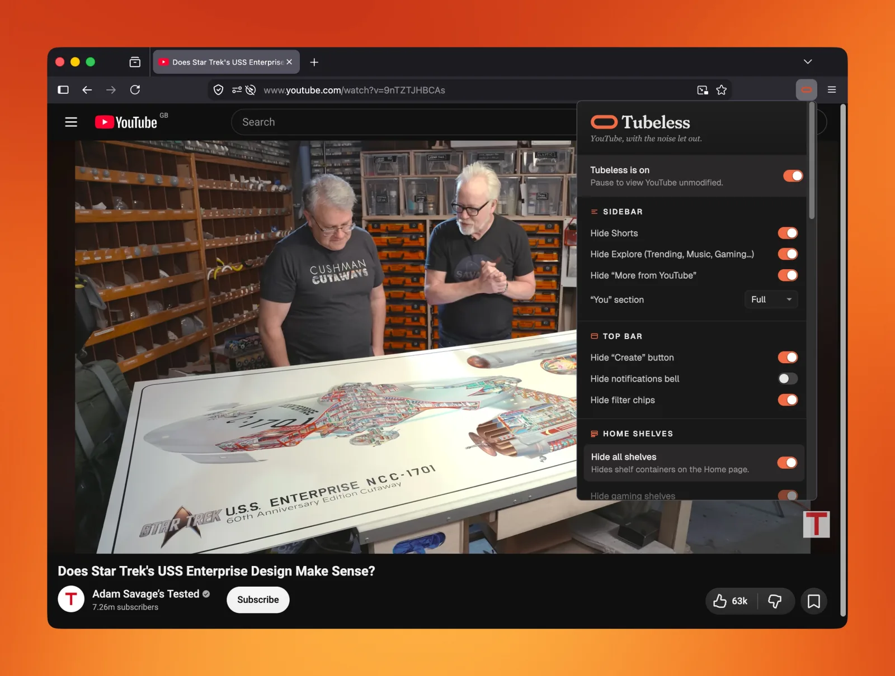
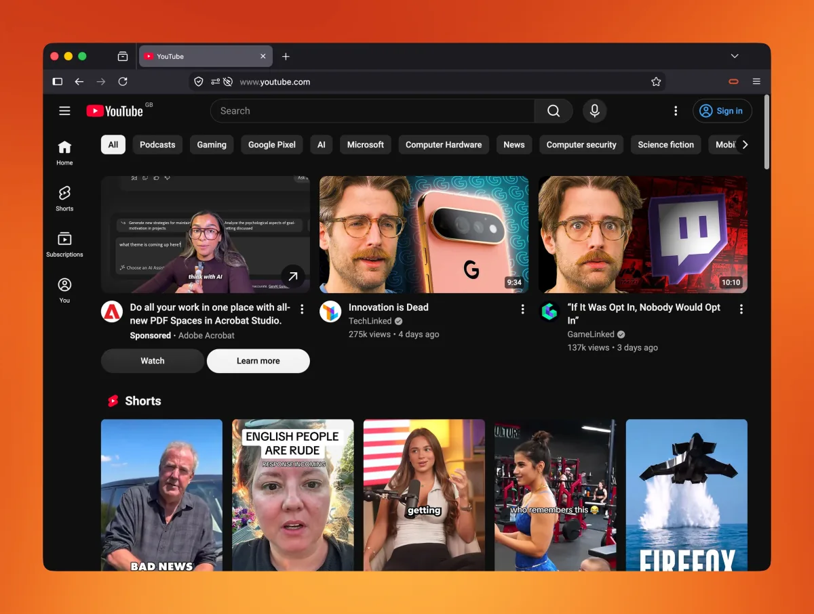
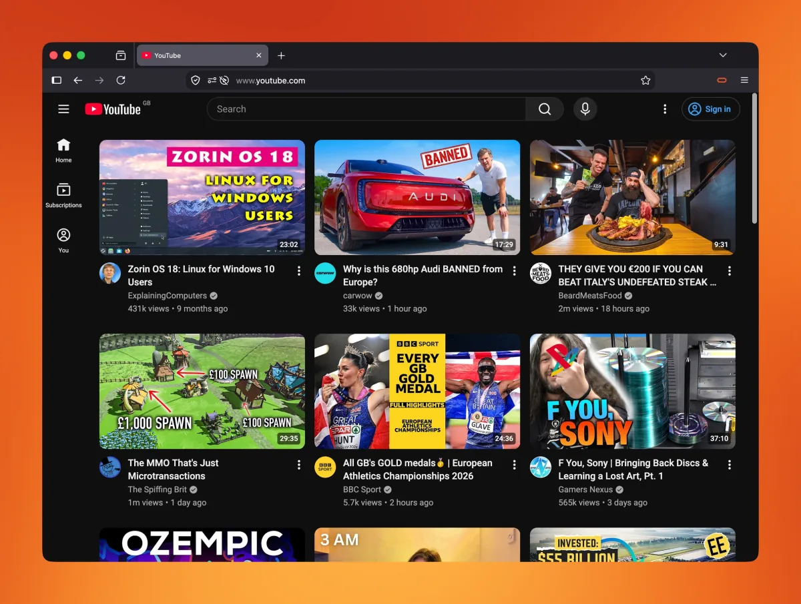
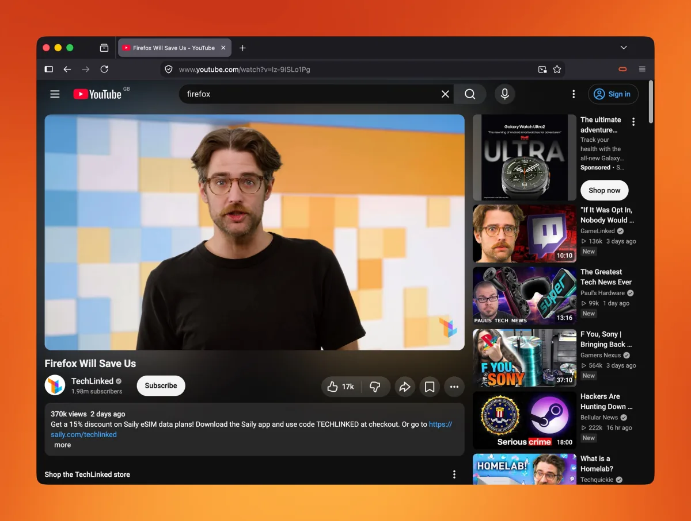
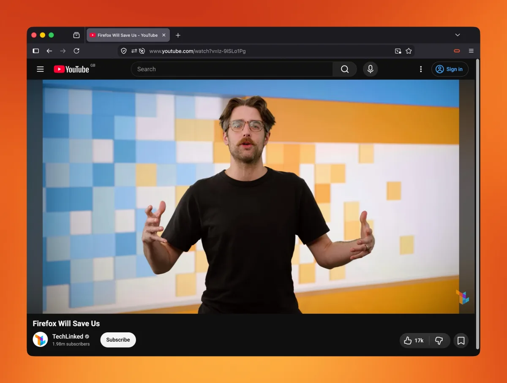

<p align="center">
  
  
</p>

<p align="center"><em>YouTube, quieter.</em></p>

<p align="center">
  <a href="https://addons.mozilla.org/firefox/addon/tubeless/"></a>
  <a href="https://chromewebstore.google.com/detail/tubeless/majebohkonlfnedomfjnjaaeioiooolg"></a>
  <a href="#privacy"></a>
  <a href="LICENSE"></a>
</p>

<p align="center"><b><a href="https://addons.mozilla.org/firefox/addon/tubeless/">Install for Firefox</a> · <a href="https://chromewebstore.google.com/detail/tubeless/majebohkonlfnedomfjnjaaeioiooolg">Install for Chrome</a> · <a href="https://tubeless.app">tubeless.app</a></b></p>

<p align="center">
  
</p>

Tubeless is a small extension for Firefox and Chrome that hides the parts of
YouTube you'd rather not see. Shorts, ads, recommendation shelves, end-screen
cards, comments: each one has its own switch in the popup, and one more brings
plain YouTube back.

Works on desktop and on Firefox for Android.

## What it hides

<table>
  <tr>
    <th width="50%">Without Tubeless</th>
    <th width="50%">With Tubeless</th>
  </tr>
  <tr>
    <td></td>
    <td></td>
  </tr>
  <tr>
    <td></td>
    <td></td>
  </tr>
</table>

Every switch works on its own, and sensible ones are on from the start. They
are grouped in the popup by where they appear:

- **Sidebar**: Shorts, Explore, "More from YouTube", and the "You" section
  (full, minimal or hidden).
- **Top bar**: the Create button, the notifications bell and the filter chips.
- **Feeds**: on Home, Subscriptions and search results, every shelf at once,
  or gaming shelves, event, alert and promo banners and feed nudges one by
  one. Shorts, movies and shows, community posts, Mixes, playlists and
  podcasts, live streams, music videos, member-only videos and Premieres.
  Channel pages are never filtered.
- **Watch page**: a trimmed row of action buttons, the merch and fundraiser
  shelves, live chat, end-screen cards, the description, comments, the
  recommendations sidebar and info panels.
- **AI**: video summaries, "Ask questions", Ask YouTube in the search bar and
  custom feed prompts.
- **Ads**: sponsored slots, display and companion ads, brand shelves, Premium
  upsells and the ad overlays on the player. This is cosmetic: an ad that
  plays inside the video still plays.
- **Popups**: survey and feedback prompts, in dialogs and in the feed.

## Why

I've been a YouTube Premium subscriber for many years. Despite this, my YouTube
feed was still cluttered with things I didn't want to see. Shorts all over the
place, "Most relevant" sections, "Explore more topics" sections, "How are we
doing?" survey blocks, more Shorts, the list goes on.

I tried numerous other extensions. Most helped, but none of them got rid of all
of it, so I created Tubeless to solve the problem. I've been using it full time
for many months with extensive YouTube browsing, and I'm constantly tweaking it.

## Install

- **Firefox**: [Firefox Add-ons](https://addons.mozilla.org/firefox/addon/tubeless/)
- **Chrome**: [Chrome Web Store](https://chromewebstore.google.com/detail/tubeless/majebohkonlfnedomfjnjaaeioiooolg)

Or [build from source](#building-from-source).

## How it works

Tubeless is a thin content script that injects a single `<style>` element into
youtube.com. Every switch in the popup maps to a CSS rule that hides specific
elements via `display: none`. There is no DOM mutation, no MutationObservers,
no background workers doing real work, and no remote code.

The full set of selectors lives in [`utils/selectors.ts`](./utils/selectors.ts),
annotated with confidence levels (`✓` stable, `?` likely-current, `!` guess).
When YouTube ships a redesign, that's the file to edit.

## Privacy

- No telemetry, no analytics, no network requests.
- The only permission requested is `storage`, used to persist your settings
  (synced through your own browser account, nowhere else).
- The manifest declares `data_collection_permissions: ['none']`.

## Reporting a problem

YouTube changes its pages often, and a change can bring back something
Tubeless used to hide, or hide something it shouldn't. Open an
[issue](https://github.com/steve-scot/tubeless/issues) saying which page it
was, what you saw, your browser and the Tubeless version from the popup. A
screenshot helps.

## Building from source

Requirements: Node 20+ and npm.

```bash
npm install
npm run dev         # WXT dev server, opens Firefox with the extension loaded
npm run dev:chrome  # same, for Chrome
npm run build       # unpacked build under .output/firefox-mv3
npm run zip         # produces .output/tubeless-<version>-firefox.zip
npm run zip:chrome  # produces .output/tubeless-<version>-chrome.zip
npm run compile     # TypeScript type-check (no emit)
```

`package-lock.json` pins every dependency, so builds are reproducible.

## Project layout

```
entrypoints/
  content.ts          Content script - injects the <style> tag
  background.ts       Firefox-for-Android shim - opens the popup in a tab
  popup/              The toolbar popup UI (HTML/CSS/TS)
utils/
  selectors.ts        Single source of truth for what each toggle hides
  buildCss.ts         Composes the injected CSS from current settings
  settings.ts         Settings schema, defaults, and storage migration
assets/
  icon.svg            Source icon - rasterised to PNG icons at build time
wxt.config.ts         WXT/manifest configuration
```

Built with [WXT](https://wxt.dev).

## Licence

[MIT](./LICENSE).

Tubeless is an independent project, not affiliated with or endorsed by YouTube
or Google.
